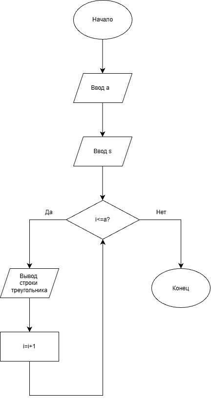

# Домашнее задание к работе 9

## Условие задачи

Разработать программу, которая выводит на экран контур равностороннего треугольника с помощью символа, введённого пользователем с клавиатуры. Размер фигуры задаётся длиной стороны треугольника. Внутренняя часть фигуры не заполняется.

## 1. Алгоритм
### Алгоритм
```
1. Начало.
2. Ввести сторону треугольника и символ.
3. Нарисовать треугольник с помощью циклов, выводя символы по контуру, а внутри — пробелы.
4. Вывести каждую строку с новой строки.
5. Конец
```
### Блок-схема


## 2. Реализация программы
```
#define _CRT_SECURE_NO_WARNINGS
#include <stdio.h>
#include <locale.h>

int main()
{
    setlocale(LC_ALL, "RUS");
    int a;
    char s;
    printf("Введите сторону треугольника: ");
    scanf("%d", &a);
    printf("Введите символ: ");
    scanf(" %c", &s);
    for (int i = 1; i <= a; i++)
    {
        for (int j = 0; j < a - i; j++)
            printf(" ");
        for (int j = 1; j <= 2 * i - 1; j++)
        {
            if (i == a || j == 1 || j == 2 * i - 1)
                printf("%c", s);
            else
                printf(" ");
        }
        printf("\n");
    }
}
```
### 3. Результаты работы программы
```
Введите сторону треугольника: 2
Введите символ: *
 *
***

Введите сторону треугольника: 4
Введите символ: #
   #
  # #
 #   #
#######
```
### 4. Информация о разработчике

Дегтярева Полина, бИЦТ-262
